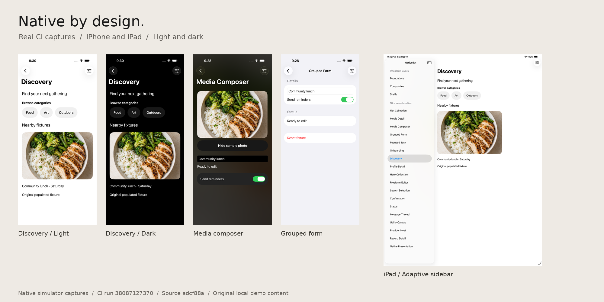
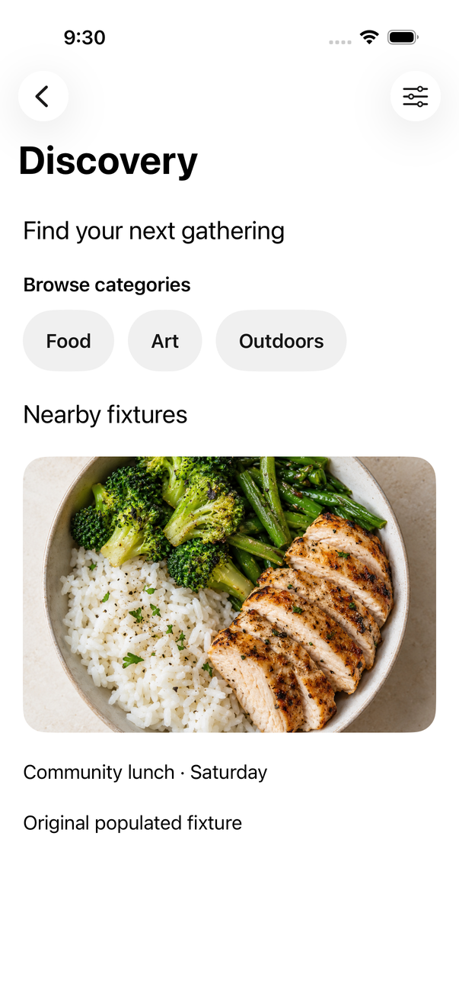
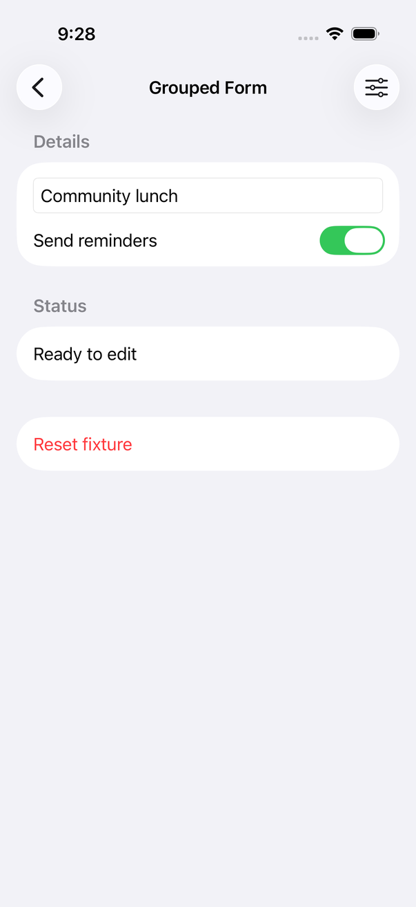
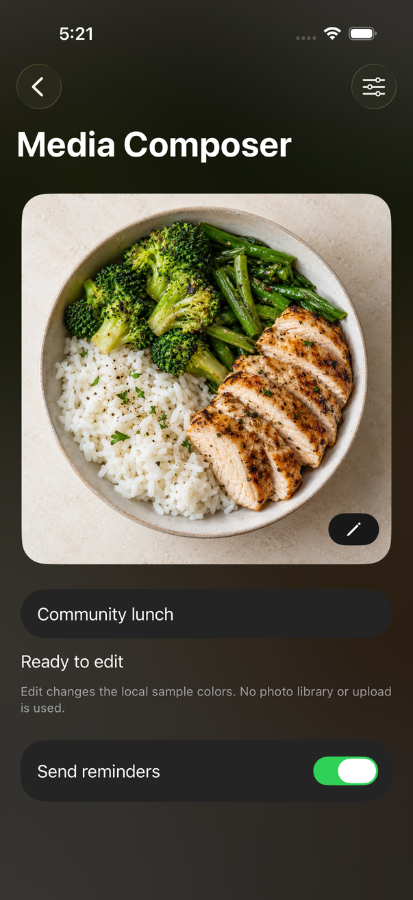

# Apple Design OS

> **A native SwiftUI design system, from component to screen.**
> One considered design language for iPhone, iPad, and Mac. Reusable layers, unified themes, and real native controls.

[](https://github.com/jangtrinh/design-os-apple/actions/workflows/ci.yml)
[](Package.swift)
[](Package.swift)
[](LICENSE)

[Explore the visual guide](https://jangtrinh.github.io/design-os-apple/) · [Browse every component](https://jangtrinh.github.io/design-os-apple/components.html) · [Get started](#add-the-package) · [Inspect tested source](https://github.com/jangtrinh/design-os-apple/tree/1898ce28861d642f57dccd88fd57afcbe3be5bb9)

<p align="center"></p>

**Shown above: historical layered kit fixtures at [`adcf88a`](https://github.com/jangtrinh/design-os-apple/tree/adcf88a468a43ed1727c9c902ae5243423e4176e).**
The layered implementation is now merged into `main` via PR 3. The overview images above retain their original historical source; the [complete component catalog](https://jangtrinh.github.io/design-os-apple/components.html) has current source-matched native previews.
The main-branch CI badge describes main. [Native CI run 38157622095](https://github.com/jangtrinh/design-os-apple/actions/runs/38157622095) verifies the current catalog source; [historical CI run 38087127370](https://github.com/jangtrinh/design-os-apple/actions/runs/38087127370) remains the provenance for the overview images.
No version tag is claimed. [Proof and image provenance](docs/marketing/proof.md).

## What it solves

Bring a consistent editorial style to native Apple apps without taking ownership away from SwiftUI.
Compose with meaningful components, reuse a screen structure, and connect your own models and actions.

- **A shared visual language.** Palette, typography, spacing, and metrics flow from an opt-in application style. Keep system, light, or dark appearance coherent across the app.
- **Considered geometry.** Continuous image corners; nested radii derived from the actual inset; full-pill styles applied to real native buttons.
- **Reusable layers.** Primitives → semantic components → composites → shells → screen types. Native navigation, focus, inputs, and presentation retain their platform owner.

Choose this for native SwiftUI composition. Plain SwiftUI may be simpler when you do not need shared design rules. This is not a cross-platform rendering engine, a backend, or a turnkey application.

## Technical register

| Fact | Contract |
| --- | --- |
| Platforms | iOS 17+, iPadOS 17+, macOS 14+ |
| Toolchain | Swift 6.2 · Swift Package Manager |
| Main product | `DesignOSApple` |
| Optional products | `DesignOSAppleExtensions`, `DesignOSAppleCatalog` |
| Package dependencies | Zero external dependencies |
| Application ownership | Your state, routes, services, native controls, and actions |
| License | MIT for original software and documentation |

Package consumers do not need DESIGN:OS maintainer tooling. The library has no first-party telemetry; this README loads external badge images, and the documentation's Markdown layout retains its existing external Buy Me a Coffee widget.

## Add the package

### Install from main

In `Package.swift`, add the package and link the product:

```swift
dependencies: [
  .package(url: "https://github.com/jangtrinh/design-os-apple.git", branch: "main")
],
targets: [
  .target(name: "MyApp", dependencies: [
    .product(name: "DesignOSApple", package: "design-os-apple")
  ])
]
```

Or choose **File > Add Package Dependencies** in Xcode, paste the repository URL, and link `DesignOSApple`.
The first compiling view is in [Getting Started](docs/getting-started.md). Its example is kept in parity with the landing page and type-checked by `scripts/verify-consumer-quickstart.sh` against the built package.

### Pin the reviewed layered kit

To pin the native revision reviewed before merging PR 3, replace the dependency above with:

```swift
.package(
  url: "https://github.com/jangtrinh/design-os-apple.git",
  revision: "1898ce28861d642f57dccd88fd57afcbe3be5bb9"
)
```

Keep the same `DesignOSApple` product dependency. Read the [kit architecture guide](https://jangtrinh.github.io/design-os-apple/kit-architecture.html) and [reusable application style](https://github.com/jangtrinh/design-os-apple/blob/adcf88a468a43ed1727c9c902ae5243423e4176e/docs/reusable-app-style.md) before adopting these APIs.

## Architecture: compose up, keep ownership clear

| Layer | Responsibility | Historical additive source |
| --- | --- | --- |
| Primitives | Geometry, clipping, adaptive placement | 3 new internal helpers |
| Semantic components | Media, identity, labeled values, status | 4 new public APIs |
| Composites | Meaningful groups with caller-owned slots | 11 new public APIs |
| Shells | One scrolling/container and safe-area policy | 9 new public APIs |
| Screen types | Named task hierarchies built from lower layers | 18 new public APIs |

**42 additive public APIs**, plus **4 native or existing-component recipes** counted separately.
These are source counts, not 42 complete apps. Existing theme/profile/token authorities support every layer.

1. **Choose the surface.** Start with the screen family that matches the user's task.
2. **Inject the style.** Apply the shared app style once at a product boundary.
3. **Connect real behavior.** Supply native controls, content, routes, state, and actions.

[Machine-readable kit index](https://github.com/jangtrinh/design-os-apple/blob/adcf88a468a43ed1727c9c902ae5243423e4176e/docs/layered-kit-index.json) · [Native layout recipes](https://github.com/jangtrinh/design-os-apple/blob/adcf88a468a43ed1727c9c902ae5243423e4176e/docs/native-layout-recipes.md) · [Design-system ownership](https://github.com/jangtrinh/design-os-apple/blob/adcf88a468a43ed1727c9c902ae5243423e4176e/docs/design-system-organization.md)

## Gallery: actual native captures

<table><tr>
<td width="33%"><br><strong>Discover &amp; collect</strong></td>
<td width="33%"><br><strong>Group &amp; refine</strong></td>
<td width="33%"><br><strong>Create &amp; edit</strong></td>
</tr></table>

Selected fixtures from **108 native family captures**, not generated mockups. Capture selection, source filenames, and transformations are recorded in the [asset manifest](docs/assets/marketing/manifest.json).
See the [visual guide](https://jangtrinh.github.io/design-os-apple/#gallery) for iPad and Mac captures.

The kit has **18 screen types**: discovery, flat collection, hero collection, media detail, record detail, profile detail, media composer, freeform editor, grouped form, search selection, message thread, onboarding, confirmation, status, focused task, utility canvas, native presentation, and provider host.

[Explore their Swift source](https://github.com/jangtrinh/design-os-apple/tree/adcf88a468a43ed1727c9c902ae5243423e4176e/Sources/DesignOSApple/Screens).

### Browse the native Gallery

On a Mac with Xcode and [XcodeGen](https://github.com/yonaskolb/XcodeGen):

```bash
xcodegen generate --spec Examples/DesignOSAppleGallery/project.yml \
  --project Examples/DesignOSAppleGallery
open Examples/DesignOSAppleGallery/DesignOSAppleGallery.xcodeproj
```

Run `DesignOSAppleGallery-iOS` or `DesignOSAppleGallery-macOS`. The Catalog provides instructional reference pages with use/avoid guidance, call sites, ownership, availability, and source paths. Launch arguments `--design-os-story <story-id>` and `--design-os-profile <profile-id>` open a specific admitted story or profile. Implementation internals stay distinct from public APIs; local demo IDs stay separate from the typed release catalog.

## Verification, with boundaries

Current component catalog: [CI run 38157622095](https://github.com/jangtrinh/design-os-apple/actions/runs/38157622095) passed all 23 workflow jobs at `1898ce2`. Its 510 reviewed native captures comprise 360 isolated component, 108 screen-family and 42 dedicated text-field-state images. These do not establish complete reference-state fidelity or full accessibility acceptance.

The overview image set retains the following historical evidence:

Current catalog source `1898ce2` passed all 23 workflow jobs in [native CI run 38157622095](https://github.com/jangtrinh/design-os-apple/actions/runs/38157622095). The reviewed evidence includes 360 isolated component captures, 108 screen-family fixtures, and 42 dedicated text-field states. The website hosts 142 iPhone previews; additional evidence is separately identified.

[Historical CI run 38087127370](https://github.com/jangtrinh/design-os-apple/actions/runs/38087127370) passed all **8 jobs** for candidate `adcf88a` (tested merge `86b686d`):

- **CalorieCam:** 10/10 UI tests on each of iPhone, iPad, and Mac.
- **Layered kit:** 9/9 UI tests on each of iPhone, iPad, and Mac.
- **Package:** 173 reported tests; the genuine high-contrast fixture was skipped.

Earlier intermittent activation failures remain unexplained. A green run does not establish live AI, physical-camera behavior, OS 27 / iPhone Duo execution, complete VoiceOver behavior, performance, or full reference-state fidelity.

[CalorieCam](https://github.com/jangtrinh/design-os-apple/blob/adcf88a468a43ed1727c9c902ae5243423e4176e/Examples/CalorieCam/README.md) is a separate native dogfood app for a photo-reference meal journal. Its offline mode uses labeled sample data, not image recognition.

On a supported Apple development environment:

```bash
swift test
scripts/verify-release-candidate.sh
```

Portable documentation checks, from the pinned source checkout:

```bash
python3 scripts/test-ukmc-verifier.py
python3 scripts/test-quickstart-parity.py
python3 scripts/verify-quickstart-parity.py
```

The portable checks do not compile SwiftUI or replace native execution. [Quality evidence](docs/quality-evidence.md) · [Portable verification](https://github.com/jangtrinh/design-os-apple/blob/adcf88a468a43ed1727c9c902ae5243423e4176e/docs/portable-verification.md) · [Evidence and provenance](docs/marketing/proof.md).

## Frequently asked questions

### What is Apple Design OS?

Apple Design OS is a zero-dependency SwiftUI design system for iOS, iPadOS, and macOS. Its layered kit adds reusable semantic components, composites, shells, and screen types while keeping native controls and application state in the consuming app.

### Which platforms and toolchain does it require?

The package requires Swift 6.2, iOS 17 or later, iPadOS 17 or later, and macOS 14 or later. It uses Swift Package Manager and has no external package dependencies.

### Is the layered kit available on main?

Yes. The layered kit was merged into main in PR 3. The component catalog is pinned to tested revision 1898ce28861d642f57dccd88fd57afcbe3be5bb9; merged main has the same source tree. Use main or pin that revision. No version tag is claimed.

### Does the catalog show every component and state?

The catalog lists 99 source entries and 160 token values. It displays 142 native iPhone images across 71 visual entries, with light and dark previews. The remaining 28 source helpers and host integrations have labeled explanatory diagrams, and all 160 token values have source-driven web illustrations. Selected previews do not establish complete behavior or every state on every platform.

### What has been verified, and what is still open?

Native CI run 38157622095 passed all 23 workflow jobs at revision 1898ce2. The reviewed capture set contains 360 isolated components, 108 screen-family fixtures and 42 dedicated text-field states across iPhone, iPad and Mac. The overview images retain their historical adcf88a provenance. Live services, physical-device behavior, complete accessibility acceptance and performance remain outside these claims.

## Ecosystem

- [design-os](https://github.com/jangtrinh/design-os): design-intent management for maintainers.
- [design-os-figma-plugin](https://github.com/jangtrinh/design-os-figma-plugin): a companion design workflow.
- [design-os-github-page](https://github.com/jangtrinh/design-os-github-page): the README and nine-tier Pages foundation used here.

## Read next

- [Getting Started](docs/getting-started.md) and [DocC runtime concepts](Sources/DesignOSApple/DesignOSApple.docc/DesignOSApple.md)
- [Candidate layered kit architecture](https://jangtrinh.github.io/design-os-apple/kit-architecture.html) and [API index](https://github.com/jangtrinh/design-os-apple/blob/adcf88a468a43ed1727c9c902ae5243423e4176e/docs/layered-kit-index.json)
- [Kit themes, corners, and pill controls](https://github.com/jangtrinh/design-os-apple/blob/adcf88a468a43ed1727c9c902ae5243423e4176e/docs/reusable-app-style.md)
- [AI usage](docs/ai-usage.md) and [native API coverage](https://github.com/jangtrinh/design-os-apple/blob/adcf88a468a43ed1727c9c902ae5243423e4176e/docs/component-coverage.md)
- [Catalog thumbnail workflow](docs/catalog-thumbnail-workflow.md) and [reference reconstruction workflow](https://github.com/jangtrinh/design-os-apple/blob/adcf88a468a43ed1727c9c902ae5243423e4176e/docs/reference-reconstruction-workflow.md)
- [Apple platform evolution](docs/apple-platform-evolution.md), [OS 27 intake](docs/os27-intake-report.md), and [historical roadmap](https://github.com/jangtrinh/design-os-apple/blob/adcf88a468a43ed1727c9c902ae5243423e4176e/docs/apple-ui-roadmap-2026-10.md)
- [Contributing](CONTRIBUTING.md) · [Support](SUPPORT.md) · [Security](SECURITY.md) · [Release process](RELEASING.md) · [Changelog](CHANGELOG.md)

Maintainers: `design/` remains managed design intent; `Sources/DesignOSApple/` remains runtime implementation. Use the documented `ui ds` workflow for managed changes. Never hand-edit `design/design.tokens.json`.

## License

Original software and documentation use the [MIT License](LICENSE). Apple Design OS is independent and is not affiliated with, endorsed by, or sponsored by Apple Inc. Apple names and trademarks belong to Apple Inc. Apple-owned resources, fonts, symbols, and template artwork are not relicensed by this project. Reference-app screenshots and branding are research provenance, not distributable product assets.
